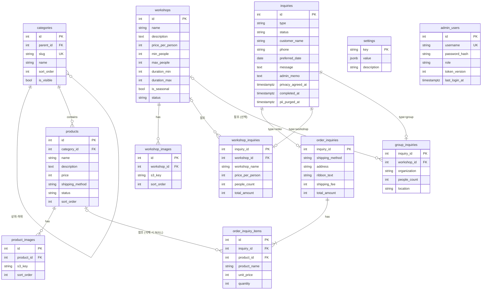

# DB 설계

PostgreSQL 기준. 테이블 12개.

## ERD

## 공통 규칙

| 규칙 | 내용 |
|---|---|
| 금액 | `INTEGER`, 원 단위. 소수점 없음 |
| 시간 | `TIMESTAMPTZ`. 모든 테이블에 `created_at`, `updated_at` |
| 상태값 | PostgreSQL `ENUM` 대신 `VARCHAR` + `CHECK` 제약 (값 추가 시 마이그레이션이 쉬움) |
| 이름 | 테이블은 복수형 snake_case. 클래스는 Python 예약어 `class`와 겹치지 않게 `workshops` |
| 사진 | 파일은 S3, DB에는 `s3_key`만 저장. 첫 번째(`sort_order` 최소) 사진이 대표 사진 |

## 테이블 상세

### categories — 상품 분류
2단계 구조. 상위 분류 아래 하위 분류.

| 상위 (`parent_id` NULL) | 하위 |
|---|---|
| 식물 `plants` | 소형 `plants-small`, 중형 `plants-medium`, 대형 `plants-large` |
| 축하화분 `celebration` | 승진 `celebration-promotion`, 개업 `celebration-opening`, 축하 `celebration-congrats` |

- 상품은 **하위 분류**에만 연결한다.
- 인테리어 오브제·소품이 추가되면 코드 변경 없이 행만 추가한다.

### products — 상품
| 컬럼 | 타입 | 설명 |
|---|---|---|
| `category_id` | FK | 하위 분류 |
| `name` | VARCHAR(100) | 상품명 |
| `description` | TEXT | 설명, 관리 방법 |
| `price` | INTEGER | 가격 (원) |
| `shipping_method` | VARCHAR | `parcel`(택배) / `local_delivery`(직접 배달) |
| `status` | VARCHAR | `on_sale`(판매중) / `sold_out`(품절) / `hidden`(숨김) |
| `sort_order` | INTEGER | 목록 표시 순서 |

### workshops — 클래스
| 컬럼 | 타입 | 설명 |
|---|---|---|
| `name` | VARCHAR(100) | 클래스명 |
| `price_per_person` | INTEGER | 1인 가격 |
| `min_people`, `max_people` | INTEGER | 1, 4 (기본값) |
| `duration_min`, `duration_max` | INTEGER | 60, 90 (분) |
| `is_seasonal` | BOOLEAN | 시즌 클래스 여부 (크리스마스 리스) |
| `status` | VARCHAR | `open`(접수중) / `closed`(마감) / `hidden`(숨김) |

초기 데이터: 화분 꾸미기 & 가드닝 30,000원, 수형 잡기 35,000원, 크리스마스 생화 리스 40,000원(시즌).

### inquiries — 문의 (공통)
문의 3종류의 공통 정보. 종류별 정보는 하위 테이블에 1:1로 저장한다.

| 컬럼 | 타입 | 설명 |
|---|---|---|
| `type` | VARCHAR | `order`(주문) / `workshop`(클래스) / `group`(단체·출강) |
| `status` | VARCHAR | `received`(접수) / `contacted`(연락함) / `completed`(완료) / `canceled`(취소) |
| `customer_name` | VARCHAR(50) | 이름 — **개인정보** |
| `phone` | VARCHAR(20) | 연락처 — **개인정보** |
| `preferred_date` | DATE | 받는 날짜 또는 희망 수업 날짜 |
| `message` | TEXT | 요청사항 |
| `admin_memo` | TEXT | 사장님 메모 (예: "12/3 통화, 24일 오전 배달") |
| `privacy_agreed_at` | TIMESTAMPTZ | 개인정보 수집 동의 시각 (NOT NULL) |
| `contacted_at`, `completed_at` | TIMESTAMPTZ | 상태가 바뀐 시각 |
| `pii_purged_at` | TIMESTAMPTZ | 개인정보를 지운 시각 |

### order_inquiries / order_inquiry_items — 주문 문의
| 컬럼 | 설명 |
|---|---|
| `shipping_method` | 택배 / 직접 배달 |
| `address` | 배송지 — **개인정보**. 매장 픽업이면 NULL |
| `ribbon_text` | 리본 문구 (축하화분) |
| `shipping_fee`, `total_amount` | 접수 시점에 계산한 예상 금액 |

`order_inquiry_items`에는 `product_name`, `unit_price`를 **접수 시점 값으로 복사**한다 (스냅샷).
상품 가격이 바뀌거나 상품이 삭제돼도 문의 내용은 그대로 남는다. `product_id`는 상품 삭제 시 NULL.

### workshop_inquiries — 클래스 예약 문의 (1~4명)
`workshop_name`, `price_per_person`을 스냅샷으로 저장. `people_count`는 1~4 (`CHECK`).

### group_inquiries — 단체·출강 문의 (5명 이상)
`organization`(기관명), `people_count`, `location`(수업 장소), `workshop_id`(희망 클래스, 선택).

### settings — 설정값
키-값 구조. 값은 JSONB, 키별 형식은 백엔드(Pydantic)에서 검증한다.

| 키 | 초기값 |
|---|---|
| `shipping.parcel_fee` | `4000` |
| `shipping.local_fee` | `5000` |
| `shipping.local_free_threshold` | `80000` |
| `shipping.local_area` | `"전주"` |
| `contact.phone`, `contact.kakao_url`, `contact.instagram` | 가게 연락처 |
| `store.address`, `store.hours` | 매장 주소, 영업시간 |
| `privacy.retention_months` | `6` (확인 필요) |

### admin_users — 관리 화면 로그인
| 컬럼 | 설명 |
|---|---|
| `role` | `owner`(사장님) / `operator`(운영자) |
| `password_hash` | argon2 또는 bcrypt 해시. 평문 저장 금지 |
| `token_version` | 기본값 0. 올리면 발급된 로그인 토큰이 모두 무효 (전체 로그아웃) |

## 개인정보 자동 삭제

매일 실행되는 작업이 아래 조건의 문의에서 개인정보를 지운다.

- 조건: `status`가 `completed` 또는 `canceled`이고, `completed_at`(또는 `updated_at`)이 `privacy.retention_months` 이전
- 처리: `customer_name` → `"(삭제됨)"`, `phone`·`address`·`ribbon_text` → NULL, `pii_purged_at` 기록
- 문의 건수, 상품, 금액 같은 통계용 정보는 남긴다.

> 보관 기간은 확인이 필요하다. 문의가 실제 거래로 이어지는 경우 전자상거래 관련 법령의 기록 보관 의무가 있을 수 있다.

## 인덱스

| 테이블 | 인덱스 | 용도 |
|---|---|---|
| `products` | `(category_id, status, sort_order)` | 손님용 상품 목록 |
| `inquiries` | `(status, created_at DESC)` | 관리 화면 문의 목록 |
| `inquiries` | `(completed_at) WHERE pii_purged_at IS NULL` | 개인정보 삭제 작업 |
| `categories` | `slug` UNIQUE | URL로 분류 조회 |
