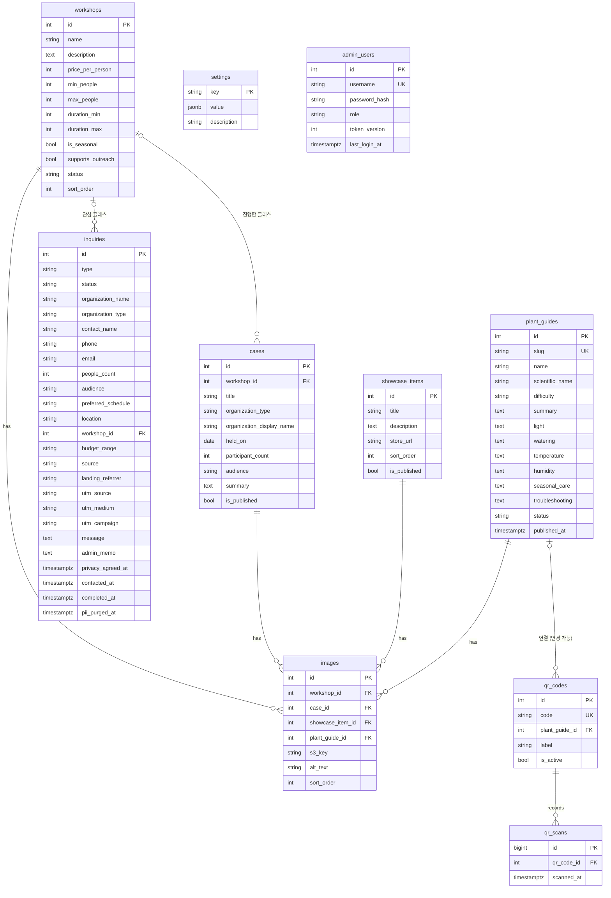

# DB 설계

PostgreSQL 기준. 테이블 10개. (2026-11-20 방향 전환 반영, ADR 0012)

## ERD



## 공통 규칙

| 규칙 | 내용 |
|---|---|
| 금액 | `INTEGER`, 원 단위 |
| 시간 | `TIMESTAMPTZ`. 모든 테이블에 `created_at`, `updated_at` (`qr_scans` 제외) |
| 상태값 | PostgreSQL `ENUM` 대신 `VARCHAR` + `CHECK` 제약 (값 추가 시 마이그레이션이 쉬움) |
| 이름 | 테이블은 복수형 snake_case. 클래스는 Python 예약어 `class`와 겹치지 않게 `workshops` |
| 사진 | 파일은 S3, DB에는 `s3_key`만 저장. `sort_order`가 가장 작은 사진이 대표 사진 |

## 테이블 상세

### workshops — 클래스·프로그램
| 컬럼 | 타입 | 설명 |
|---|---|---|
| `name` | VARCHAR(100) | 클래스명 |
| `description` | TEXT | 소개, 준비물, 진행 순서 |
| `price_per_person` | INTEGER | 1인 가격 |
| `min_people`, `max_people` | INTEGER | 매장 개인 수업 인원 (기본 1, 4) |
| `duration_min`, `duration_max` | INTEGER | 60, 90 (분) |
| `is_seasonal` | BOOLEAN | 시즌 클래스 여부 (크리스마스 리스) |
| `supports_outreach` | BOOLEAN | 출강·단체 수업 가능 여부 |
| `status` | VARCHAR | `open`(접수중) / `closed`(마감) / `hidden`(숨김) |

초기 데이터: 화분 꾸미기 & 가드닝 30,000원, 수형 잡기 35,000원, 크리스마스 생화 리스 40,000원(시즌).

### cases — 출강·단체 수업 진행 사례
| 컬럼 | 타입 | 설명 |
|---|---|---|
| `workshop_id` | FK, NULL 허용 | 진행한 클래스. 클래스가 삭제되면 NULL |
| `title` | VARCHAR(100) | 예: "초등학생 20명과 함께한 다육 화분 만들기" |
| `organization_type` | VARCHAR | `school` / `kindergarten` / `welfare` / `public` / `company` / `other` |
| `organization_display_name` | VARCHAR(100) | 화면에 보여줄 이름. 기관 동의가 없으면 "전주 ○○초등학교"처럼 가린 이름 |
| `held_on` | DATE | 진행 날짜 |
| `participant_count` | INTEGER | 인원 |
| `audience` | VARCHAR | `children` / `teens` / `adults` / `seniors` / `mixed` |
| `summary` | TEXT | 진행 내용, 후기 |
| `is_published` | BOOLEAN | 공개 여부 |

### showcase_items — 작품 갤러리
| 컬럼 | 설명 |
|---|---|
| `title`, `description` | 작품 이름, 설명 |
| `store_url` | 스마트스토어 상품 주소 (선택). 가격·재고는 스마트스토어가 기준 |
| `sort_order`, `is_published` | 표시 순서, 공개 여부 |

### plant_guides — 식물 관리 가이드
| 컬럼 | 타입 | 설명 |
|---|---|---|
| `slug` | VARCHAR(60) UNIQUE | URL용 이름 (`monstera`). **공개 후에는 바꾸지 않는다** |
| `name`, `scientific_name` | VARCHAR | 이름, 학명 |
| `difficulty` | VARCHAR | `easy` / `normal` / `hard` |
| `summary` | TEXT | 한 줄 요약 (검색 결과 설명으로도 쓴다) |
| `light`, `watering`, `temperature`, `humidity` | TEXT | 항목별 관리법 |
| `seasonal_care` | TEXT | 계절별 관리 |
| `troubleshooting` | TEXT | 자주 생기는 문제와 해결법 |
| `status` | VARCHAR | `draft`(작성 중) / `published`(공개) |
| `published_at` | TIMESTAMPTZ | 처음 공개한 시각 |

### images — 사진 (공용)
여러 테이블의 사진을 하나로 관리한다. 4개 FK 중 **정확히 하나만** 값이 있어야 한다.

```sql
CHECK (num_nonnulls(workshop_id, case_id, showcase_item_id, plant_guide_id) = 1)
```

- 각 FK는 `ON DELETE CASCADE`. 행이 지워지면 S3 파일은 백엔드가 같이 지운다.
- `alt_text`: 이미지 설명 (접근성, 검색 노출).

### qr_codes — QR 코드
| 컬럼 | 타입 | 설명 |
|---|---|---|
| `code` | VARCHAR(8) UNIQUE | 짧은 코드. 헷갈리는 문자(0/O, 1/I/L)를 뺀 대문자·숫자 6자리 |
| `plant_guide_id` | FK, NULL 허용 | 연결된 가이드. 관리 화면에서 바꿀 수 있다. 가이드 삭제 시 NULL |
| `label` | VARCHAR(100) | 관리용 메모 (예: "2026-12 몬스테라 카드 100장") |
| `is_active` | BOOLEAN | 비활성이어도 404 대신 가이드 목록으로 보낸다 (ADR 0013) |

**QR 코드 행은 지우지 않는다.** 이미 인쇄된 카드가 있기 때문이다.

### qr_scans — QR 스캔 기록
| 컬럼 | 설명 |
|---|---|
| `qr_code_id` | FK |
| `scanned_at` | 스캔 시각 |

IP, 기기 정보는 저장하지 않는다. 스캔 수 집계용.

### inquiries — 출강·단체 견적 문의
| 컬럼 | 타입 | 설명 |
|---|---|---|
| `type` | VARCHAR | `outreach`(출강) / `group_visit`(매장 단체 수업) / `corporate_order`(기업 대량 화분) / `other` |
| `status` | VARCHAR | `received`(접수) / `contacted`(연락함) / `quoted`(견적 보냄) / `confirmed`(확정) / `completed`(완료) / `canceled`(취소) |
| `organization_name` | VARCHAR(100) | 기관명 |
| `organization_type` | VARCHAR | `cases.organization_type`과 같은 값 |
| `contact_name` | VARCHAR(50) | 담당자 이름 — **개인정보**. 개인정보 삭제 후에만 NULL (CHECK, 마이그레이션 0003) |
| `phone` | VARCHAR(20) | 연락처 — **개인정보** |
| `email` | VARCHAR(255) | 이메일 (선택) — **개인정보** |
| `people_count` | INTEGER | 인원 |
| `audience` | VARCHAR | 대상 (선택) |
| `preferred_schedule` | VARCHAR(200) | 희망 일정 (자유 입력) |
| `location` | VARCHAR(200) | 수업 장소 (출강일 때) |
| `workshop_id` | FK, NULL 허용 | 관심 클래스 |
| `budget_range` | VARCHAR | 예산 범위 (선택) |
| `source` | VARCHAR | 손님이 고른 유입 경로: `search` / `instagram` / `qr` / `referral` / `returning` / `other` |
| `landing_referrer`, `utm_source`, `utm_medium`, `utm_campaign` | VARCHAR | 페이지가 자동 기록한 첫 방문 경로 |
| `message` | TEXT | 요청사항 |
| `admin_memo` | TEXT | 사장님 메모 |
| `privacy_agreed_at` | TIMESTAMPTZ | 개인정보 수집 동의 시각 (NOT NULL) |
| `contacted_at`, `completed_at` | TIMESTAMPTZ | 상태가 바뀐 시각 |
| `pii_purged_at` | TIMESTAMPTZ | 개인정보를 지운 시각 |

`confirmed`, `completed` 문의 수가 "홈페이지로 늘어난 출강"의 근거가 된다.

### settings — 설정값
키-값 구조. 값은 JSONB, 키별 형식은 백엔드(Pydantic)에서 검증한다.

| 키 | 예시 | 사장님 수정 |
|---|---|---|
| `contact.phone`, `contact.kakao_url`, `contact.instagram` | 가게 연락처 | O |
| `links.smartstore_url`, `links.naver_place_url` | 외부 채널 주소 | O |
| `store.address`, `store.hours` | 매장 주소, 영업시간 | O |
| `outreach.service_area` | `"전주, 완주, 익산"` | O |
| `outreach.brochure_s3_key` | 소개서 PDF 위치 | O (파일 업로드) |
| `privacy.retention_months` | `6` (확인 필요) | X (운영자만) |

### admin_users — 관리 화면 로그인
| 컬럼 | 설명 |
|---|---|
| `role` | `owner`(사장님) / `operator`(운영자) |
| `password_hash` | argon2 해시. 평문 저장 금지 |
| `token_version` | 기본값 0. 올리면 발급된 로그인 토큰이 모두 무효 (전체 로그아웃) |

## 개인정보 자동 삭제

매일 한국 시간 03:30에 서버 타이머가 실행한다 (`backend/app/purge.py`, `deploy/systemd/dowha-pii-purge.*`).

- 조건: `status`가 `completed` 또는 `canceled`이고, `completed_at`이 `privacy.retention_months`(기본 6, 1~60) 개월 이전
  - 개월 계산은 PostgreSQL interval (5월 31일 + 6개월 = 11월 30일)
  - 끝난 문의를 다시 진행 중으로 돌리면 `completed_at`이 지워져 대상에서 빠진다 (관리 API)
- 처리: `contact_name`·`phone`·`email` → NULL, `message`·`admin_memo` → 빈 문자열, `pii_purged_at` 기록
  - 요청사항과 메모는 자유 입력이라 연락처가 섞여 있을 수 있어서 같이 지운다
  - 처음 설계는 이름을 `"(삭제됨)"`으로 바꾸는 것이었지만, NULL + CHECK(마이그레이션 0003)로 바꿨다. 가짜 값은 실제 이름과 구별되지 않는다
- 기관명, 기관 유형, 인원, 일정, 장소, 유입 경로, 상태, 시각은 통계용으로 남긴다.
- 감시: API 지표 `dowha_inquiries_pii_overdue`(기한 + 2일이 지났는데 남은 수)가 1시간 넘게 0보다 크면 경보 `PiiPurgeOverdue`.
  타이머가 멈췄는지가 아니라 결과를 보므로, 타이머 정지·코드 오류·설정 오류를 하나의 경보로 잡는다.
- 진행 중 상태로 오래 방치된 문의는 대상이 아니다. 사장님이 끝내거나 취소해야 보관 기간이 시작된다.

> 보관 기간은 확인이 필요하다. 견적과 계약이 실제로 이뤄진 경우 관련 법령의 기록 보관 의무가 있을 수 있다.

## 인덱스

| 테이블 | 인덱스 | 용도 |
|---|---|---|
| `inquiries` | `(status, created_at DESC)` | 관리 화면 문의 목록 |
| `inquiries` | `(created_at, source)` | 월별·유입 경로별 집계 (Grafana) |
| `inquiries` | `(completed_at) WHERE pii_purged_at IS NULL` | 개인정보 삭제 작업 |
| `qr_codes` | `code` UNIQUE | QR 리디렉션 |
| `qr_scans` | `(qr_code_id, scanned_at)` | 코드별·기간별 스캔 수 |
| `plant_guides` | `slug` UNIQUE | 가이드 페이지 조회 |
| `cases` | `(is_published, held_on DESC)` | 사례 목록 |
| `images` | 각 FK + `sort_order` | 대표 사진 조회 |
